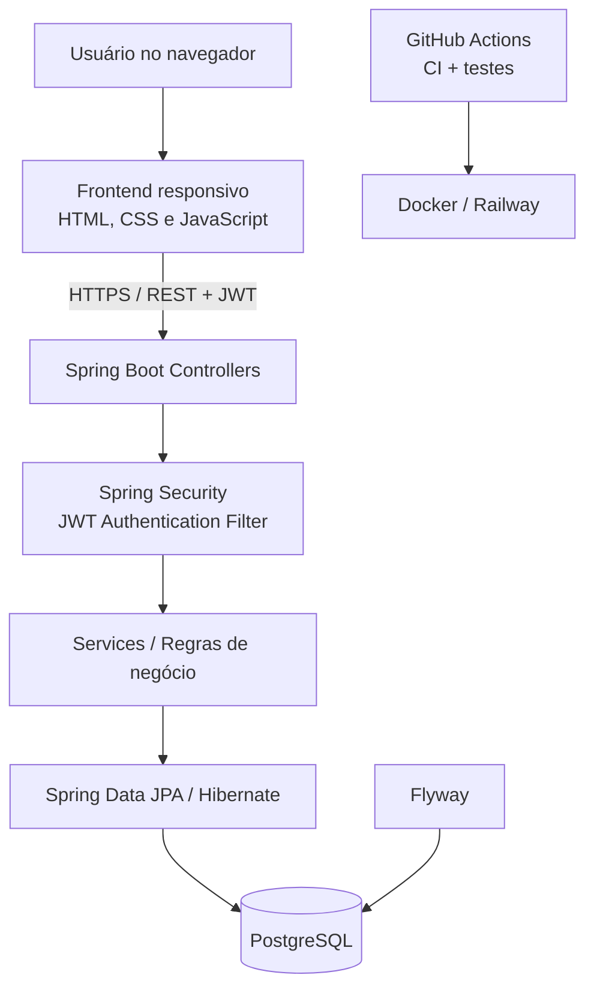

# 📇 Phonebook | Full-Stack Contact Manager

<p align="center">
  <strong>Aplicação full-stack para gerenciamento de contatos, com autenticação JWT, API REST em Java e deploy na nuvem.</strong>
</p>

<p align="center">
  <a href="https://springboot-phonebook-production.up.railway.app/"></a>
  <a href="https://github.com/ericvpereira/springboot-phonebook/actions/workflows/phonebook-ci.yml"></a>
</p>

<p align="center">
  
  
  
  
  
</p>

<p align="center">
  <a href="https://springboot-phonebook-production.up.railway.app/"><strong>🌐 Experimentar o Phonebook</strong></a> ·
  <a href="https://springboot-phonebook-production.up.railway.app/swagger-ui/index.html">📚 Swagger UI</a> ·
  <a href="docs/DEPLOY.md">📖 Guia de deploy</a>
</p>

---

## 💡 Sobre o projeto

O **Phonebook** começou como uma API REST para gerenciamento de contatos e evoluiu para uma aplicação **full-stack responsiva**, com interface web integrada ao Spring Boot, persistência em PostgreSQL e publicação no Railway.

O objetivo é demonstrar competências aplicadas ao desenvolvimento **Backend Java**, incluindo modelagem e persistência de dados, segurança, regras de autorização, migrations, testes automatizados, CI e containerização.

### Principais funcionalidades

- **Cadastro e login** de usuários com senhas protegidas por BCrypt e autenticação baseada em JWT.
- **Agenda de contatos** com criação, listagem, visualização, edição e exclusão autorizada.
- **Isolamento de dados por usuário:** cada usuário acessa somente os próprios contatos.
- **Busca, filtros por categoria e favoritos** (favoritos armazenados localmente no navegador).
- **Interface responsiva** para desktop e dispositivos móveis.
- **Autorização por perfis:** a exclusão de contatos exige permissão de **ADMIN**.
- **Migrations versionadas** com Flyway e monitoramento de saúde via Spring Boot Actuator.

> **Experimente:** abra a [aplicação online](https://springboot-phonebook-production.up.railway.app/), crie uma conta e gerencie sua agenda. A aplicação não oferece recuperação de senha: utilize uma senha exclusiva para testes, sem reutilizar credenciais pessoais.

## 🏗️ Arquitetura



A API segue uma **arquitetura em camadas**, separando controllers, services, repositories, entities, DTOs e componentes de segurança. O frontend é servido pela própria aplicação Spring Boot, dispensando um servidor web separado.

## 🛠️ Tecnologias

| Camada | Tecnologias |
| --- | --- |
| Backend | Java 17, Spring Boot 3.5.3, Spring Web |
| Segurança | Spring Security, JWT (JJWT), BCrypt |
| Dados | PostgreSQL, Spring Data JPA, Hibernate, Flyway |
| Frontend | HTML5, CSS3 e JavaScript |
| API | REST, Bean Validation, Swagger/OpenAPI |
| Testes | JUnit 5, Mockito, Spring Security Test, H2, Node.js e Chromium/Playwright |
| DevOps | Maven Wrapper, Docker, Docker Compose, GitHub Actions e Railway |
| Observabilidade | Spring Boot Actuator (`/actuator/health`) |

## 🔐 Autenticação e autorização

A aplicação utiliza **JWT stateless**. Após o login, o frontend envia o token no cabeçalho `Authorization: Bearer <token>` para acessar rotas protegidas.

| Método | Endpoint | Acesso | Descrição |
| --- | --- | --- | --- |
| POST | `/auth/register` | Público | Criar conta |
| POST | `/auth/login` | Público | Autenticar e receber JWT |
| GET | `/contacts` | Autenticado | Listar os próprios contatos |
| GET | `/contacts/{id}` | Autenticado | Consultar contato próprio |
| POST | `/contacts` | Autenticado | Cadastrar contato |
| PUT | `/contacts/{id}` | Autenticado | Atualizar contato próprio |
| DELETE | `/contacts/{id}` | ADMIN | Excluir contato próprio |
| GET | `/actuator/health` | Público | Saúde da aplicação |

A propriedade do contato é definida no backend a partir do usuário autenticado. Tentativas de acessar contatos pertencentes a outra conta não retornam seus dados.

### Exemplo de autenticação

```http
POST /auth/login
Content-Type: application/json

{
  "username": "usuario",
  "password": "sua_senha"
}
```

Resposta de sucesso (formato simplificado):

```json
{
  "token": "SEU_TOKEN_JWT"
}
```

Para chamadas autenticadas:

```http
Authorization: Bearer SEU_TOKEN_JWT
```

## 🧪 Testes e integração contínua

O workflow [**CI - Phonebook**](.github/workflows/phonebook-ci.yml) executa automaticamente verificações da aplicação.

| Validação | Resultado da execução verificada |
| --- | --- |
| Testes Java (JUnit / Spring) | **38 aprovados**, sem falhas |
| Testes automatizados de frontend | **4 aprovados**, sem falhas |
| Compilação e empacotamento Maven | **BUILD SUCCESS** |
| Construção da imagem Docker | **Aprovada** |
| Teste ponta a ponta com PostgreSQL e Chromium | **Aprovado** |

Esses resultados foram confirmados no [GitHub Actions — execução #20](https://github.com/ericvpereira/springboot-phonebook/actions/runs/41865128547). O teste E2E cobre autenticação, operações de contato, regras de acesso, isolamento entre usuários e fluxo no navegador.

Para executar a suíte Java localmente:

```bash
./mvnw clean verify
```

No Windows:

```powershell
.\mvnw.cmd clean verify
```

## 🐳 Executando localmente com Docker Compose

**Pré-requisitos:** Git e Docker Desktop (ou Docker Engine + Compose).

```bash
git clone https://github.com/ericvpereira/springboot-phonebook.git
cd springboot-phonebook
```

Crie o arquivo `.env` a partir de `.env.example` e defina senhas fortes para o PostgreSQL e uma chave aleatória forte em `JWT_SECRET` (mínimo de 32 bytes). **Nunca envie o arquivo `.env` ao GitHub.**

```bash
docker compose up --build -d
```

Acesse:

- Interface: **http://localhost:8080/**
- API Swagger: **http://localhost:8080/swagger-ui/index.html**
- Healthcheck: **http://localhost:8080/actuator/health**

Para visualizar logs:

```bash
docker compose logs -f app
```

Para encerrar, preservando o volume do banco:

```bash
docker compose down
```

> Não utilize `docker compose down -v` se desejar manter os dados do banco.

## ☁️ Deploy no Railway

A aplicação está publicada com um serviço **Spring Boot em Docker** e um serviço **PostgreSQL** no Railway. O banco usa armazenamento persistente e a conexão é configurada com variáveis de ambiente.

**URL pública:** https://springboot-phonebook-production.up.railway.app/

Variáveis esperadas no **serviço da aplicação** (não no serviço Postgres):

| Variável | Finalidade |
| --- | --- |
| `SPRING_DATASOURCE_URL` | URL JDBC do PostgreSQL |
| `SPRING_DATASOURCE_USERNAME` | Usuário do banco |
| `SPRING_DATASOURCE_PASSWORD` | Senha do banco |
| `JWT_SECRET` | Chave secreta do JWT |
| `JWT_EXPIRATION` | Expiração em milissegundos (padrão: `3600000`) |
| `PORT` | Porta HTTP (padrão: `8080`) |

Credenciais reais e chaves secretas **não são armazenadas no repositório**. Consulte [docs/DEPLOY.md](docs/DEPLOY.md) para orientações de publicação e migração de dados.

## 📂 Estrutura do projeto

```text
src/
├── main/
│   ├── java/com/eric/phonebook/
│   │   ├── config/
│   │   ├── controllers/
│   │   ├── dto/
│   │   ├── entities/
│   │   ├── exceptions/
│   │   ├── repositories/
│   │   ├── security/
│   │   └── services/
│   └── resources/
│       ├── db/migration/        # Migrações Flyway
│       ├── static/              # Frontend integrado
│       └── application.properties
├── test/                         # Testes Java
tests/                            # Testes frontend e E2E
Dockerfile                        # Build multi-stage
docker-compose.yml                # Ambiente local
.github/workflows/                # CI
docs/DEPLOY.md                    # Documentação de deploy
```

## 🧭 Evolução e próximos passos

O projeto já conta com API, frontend, segurança JWT, persistência, migrations, testes e deploy. Melhorias futuras planejadas podem incluir recuperação de senha, verificação de e-mail, testes de carga, backups automatizados e aprimoramentos de acessibilidade.

## 👨‍💻 Autor

**Eric Vieira Pereira** — Desenvolvedor Backend Java em formação contínua, com foco em Spring Boot, APIs REST, banco de dados e qualidade de software.

- [LinkedIn](https://www.linkedin.com/in/ervp/)
- [GitHub](https://github.com/ericvpereira)
- [Phonebook em produção](https://springboot-phonebook-production.up.railway.app/)

---

<p align="center"><strong>Java · Spring Boot · PostgreSQL · Security · Docker · CI/CD · Railway</strong></p>
